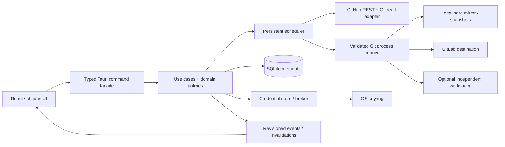

# Architecture - modular desktop application

## Decision

Use a single native process with a modular Rust core and an unprivileged React renderer.
Do not introduce a backend server, Redis, broker, microservices or headless daemon in V1.
The system Git CLI is an external process adapter, not business logic in the renderer.



## Module boundaries

Proposed tree to create in P01 (these files do not yet exist in this blueprint):

```text
apps/desktop/
  src/
    app/                    # router, shell, providers
    components/ui/          # audited shadcn primitives
    components/shared/      # status badge, async view, job progress
    features/{onboarding,dashboard,repositories,sync,activity,connections,settings}/
    lib/native/             # only invoke/event bridge, runtime validation
    lib/icons/              # semantic registry, audited brand assets
    test/                   # fixtures and adapter fakes, never production fallback
  src-tauri/
    src/{commands,bootstrap,events}/
    capabilities/
crates/
  domain/                   # pure IDs, state derivation, ref diff, policies
  application/              # use cases, ports, plan/apply/verify orchestration
  infrastructure/           # git, github, gitlab, sqlite, keyring, platform modules
contracts/                  # committed application DTO contract
```

Keep infrastructure modules inside one crate initially. Split crates only for an actual
isolation/build/dependency benefit. Domain depends on neither application nor adapters.
Application depends on domain and narrow ports. Infrastructure implements those ports.
Tauri bootstrap wires implementations; UI invokes use cases, not infrastructure.

## State ownership

SQLite owns catalog, mappings, jobs, observations, settings and audit records. Keyring
owns persistent tokens. App-owned filesystem stores mirrors/snapshots; Git owns object
integrity, but the application validates ownership, ref scope and sequencing. React
owns presentation state only. Derived summaries are computed once in native code from
one logical snapshot/revision to avoid disagreeing counts between screens.

## Synchronization

One process-wide scheduler, durable per-repo job identity, per-repo mutation lock and
bounded provider/Git concurrency. Native events signal committed revisions; missed or
out-of-order events cause safe re-query. No log stream doubles as a job state machine.
Commands return promptly with job IDs for long work; no long-lived IPC request waits
for an entire clone.

## Operational trade-offs

System Git requires an installed compatible binary and a secure credential bridge, but
reduces protocol reimplementation. Tauri requires real Linux WebKitGTK/native testing;
a browser-only pass is insufficient. SQLite is deliberately local and simple; remote
multi-user coordination is outside scope. See [decisions](DECISIONS.json).
