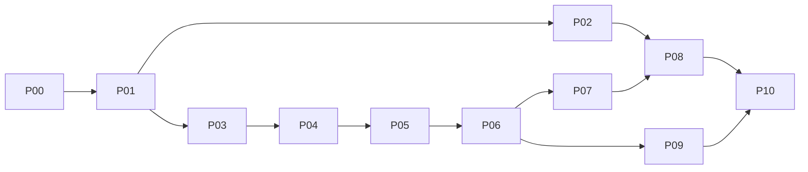

# Implementation roadmap

Execute a dependency graph, not a single giant "build everything" instruction.

| Phase | Outcome | Depends on | Tasks |
|---|---|---|---|
| [P00](phases/P00.md) | Reconnaissance and decision ledger | none | 3 |
| [P01](phases/P01.md) | Foundation and typed boundaries | P00 | 3 |
| [P02](phases/P02.md) | UI baseline, components and first vertical slice | P01 | 4 |
| [P03](phases/P03.md) | Persistence, credentials and account setup | P01 | 4 |
| [P04](phases/P04.md) | Discovery, identity and source observation | P03 | 3 |
| [P05](phases/P05.md) | Safe local Git engine and recovery foundation | P04 | 4 |
| [P06](phases/P06.md) | GitLab plan, apply and verification | P05 | 4 |
| [P07](phases/P07.md) | Persistent scheduling, retry and events | P06 | 3 |
| [P08](phases/P08.md) | Complete UI workflows on real native contracts | P02, P07 | 5 |
| [P09](phases/P09.md) | LFS, dependency coverage and full restore | P06 | 3 |
| [P10](phases/P10.md) | Hardening and Linux release acceptance | P08, P09 | 4 |

## Milestones

M1: P01 buildable native shell and typed contracts. M2: P02 owner-reviewed UI slice. M3: P06 safe basic one-way Git backup. M4: P08 complete native-wired UI. M5: P09 actual coverage/restore proof. M6: P10 verified Linux release candidate. Do not advertise M3 as full V1 if LFS/native/visual acceptance is incomplete.

## Deferred P11 (not authorized by V1)

Browser authorization with actual app registrations; Windows/macOS packaging and native acceptance; custom enterprise hosts; single-project GitLab bundle archive; separate daemon; automatic retention cleanup; repository metadata/issues/releases backup. Each requires a change record, contract/security/UI updates and its own tests before implementation.

## Parallelism

P02 can proceed in parallel with P03-P07 after P01, provided agents use separate branches/worktrees and no shared contract/migration files. P09 can proceed after P06 without waiting for every UI page. Integrator owns shared contracts and lockfiles. See agents/COORDINATION.md.
